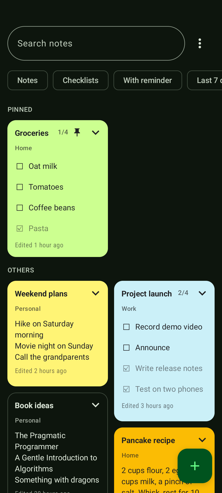
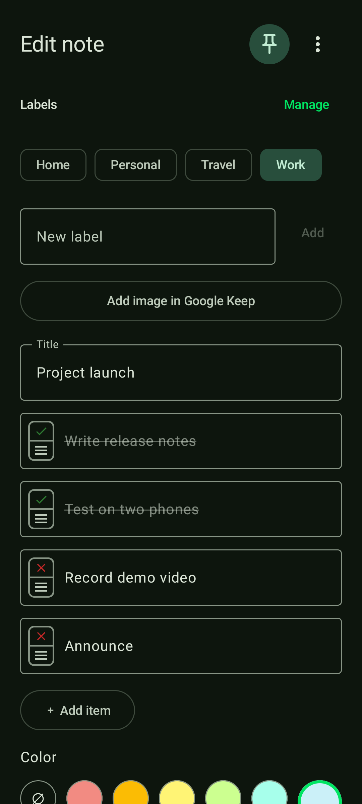
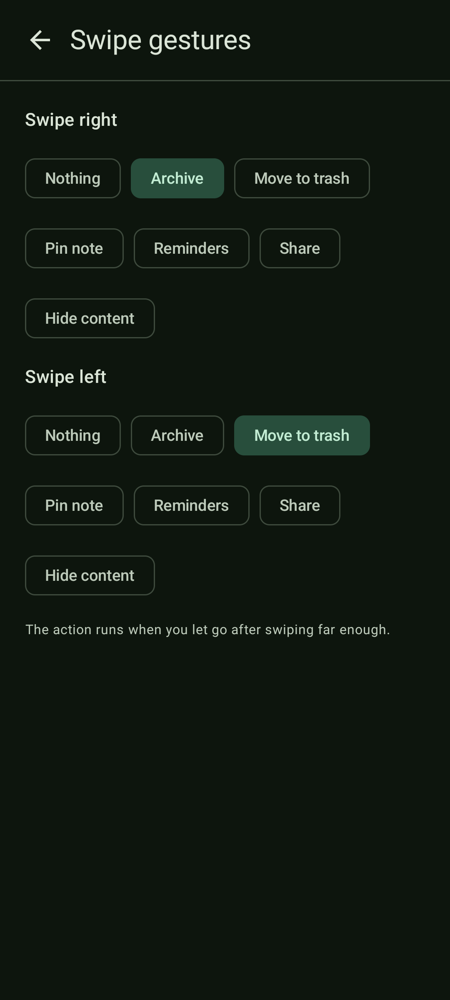
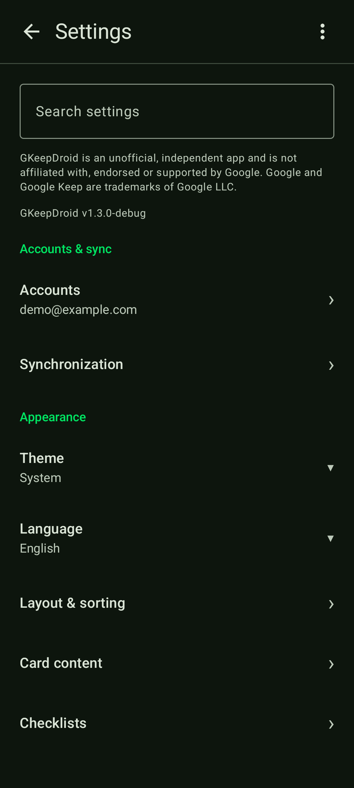
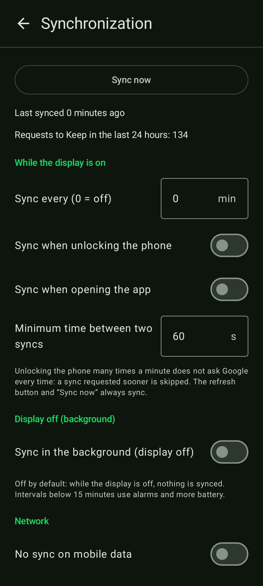
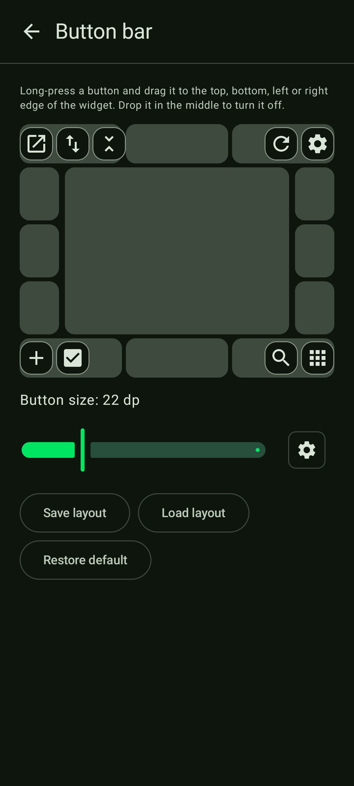

# GKeepDroid

An unofficial Android app for your Google Keep notes: home screen widgets with a fully transparent background, and a full-screen app to read and edit all your notes.

> **Not affiliated with Google.** GKeepDroid is an independent, unofficial project. Google Keep and Google are trademarks of Google LLC. This app is neither made, endorsed nor supported by Google.

| Notes | Checklist editor | Swipe gestures | Settings | Synchronization | Button bar |
|---|---|---|---|---|---|
|  |  |  |  |  |  |

## Features

- **Two widgets**: *Keep Notes* lists all notes of an account (optionally only one label), *Keep Note* shows a single note or checklist, such as a shopping list
- **Widget look**: background opacity from 0 to 100 %, text size and color, Keep's note colors, cards for notes without a color (transparent, gray or with a border)
- **Button bar**: every button (refresh, new note, search, ...) can be hidden or dragged to any side of the widget, in any order, with an adjustable size; the settings page shows a live preview of the bar
- **Reminders**: several per note, each with its own sound, vibration and silent-mode setting, snooze, quick times you define, shown on the cards and in the widgets. They live on the phone only, Keep's own reminders are not synced
- **Checklists**: tick items right in the widget or on the cards of the app, checked items move to the end (or are hidden), "3/7" progress, drag items to re-order them, check/uncheck all, sort A–Z, delete checked, dividers (a line of dashes, also an item of its own in Keep), convert between note and checklist (also from lines starting with "-" or "1."), numbered checklists (the numbers are part of the text, so Keep shows them too), automatic list numbering while typing
- **Folding**: a small arrow folds a note to its title in the app and, optionally, in the widgets
- **Full app**: grid or list of all notes, search with a customizable filter bar (notes, checklists, with reminder, last 7 days, with image, pinned, labels), archive and trash, undo, long-press to re-order notes (also in archive and trash) in Keep's order, images, sharing
- **Swipe gestures**: swipe a card left or right to archive, trash, pin, set a reminder, share or hide it; the action runs when you let go, and you choose it for each direction
- **Links**: web addresses, e-mail addresses and phone numbers in notes open in the app made for them
- **Keep's look**: bold, italic, underline, strikethrough and headings from Keep's editor, and Keep's background pictures, show on the cards of the app. In the widgets, formatting shows for a whole line or item (a widget cannot style a single word). In the app's editor you format the selected text from Android's selection menu, and it is sent to Keep. Color and background are set separately in the editor, which also takes on the note's look, with the light or dark version of the color and picture. Besides Keep's pictures a note can have a photo of your own as its background, and its own text color; both stay on the phone and Keep does not know about them. The pictures are fetched once from Google's servers (`www.gstatic.com`) and kept on the device
- **Editor**: one bar on top (discard, pin, reminder, save, menu) and one above the keyboard (color and background, labels, undo and redo), Undo and Redo for text, items, color, labels and more (Ctrl+Z with a keyboard; the steps stay for ten minutes after saving), and a short note sits in the middle of the screen, at the top or at the bottom, as you choose
- **Your own editor buttons**: every button of the editor (and every entry of its menu) can be dragged to the top bar, the bottom bar, the menu or hidden, in any order, in the settings. The note itself is a button too: put the actions with a name, the picture button, or the color and label sections before or after it, and they show right above or below the note instead of in a bar or a sheet. Every button can go anywhere (only the note stays in its place). The settings page shows a live preview of the editor while you drag, and has a shortcut in the editor's menu. The layout can be saved to a file and loaded again
- **Labels**: create, assign, delete and filter by them
- **Private notes**: "Hide content" shows only the title on the cards and in the widgets and asks for the device lock (PIN, pattern, fingerprint) to open. The mark is a special label in Keep, so devices with the same account agree on it
- **Locks**: lock the whole app, or only editing (reading stays free), or only ticking items in widgets, each with its own grace time; the security settings always ask; optionally widgets show only titles while the app is locked. Works with fingerprint or face from Android 10, with PIN, pattern or password on Android 8 and 9
- **Sign in** with your Google account, with a master token, or **without an account** (notes stay on the device). Several accounts are possible
- **Sync you control**: an interval while the display is on, sync on unlock and on opening the app, optional background sync, a minimum gap between syncs, none on mobile data. Edits made offline are sent later
- **Saving never makes you wait**: the editor closes at once, the change shows up in the app and widgets right away and is sent to Keep in the background. A change is kept on the phone until Keep has it; if sending fails, a notification offers "Try again" and "Discard"
- **Markdown folder, synced both ways**: every note is its own `.md` file; edit it in another app (Obsidian, Markor, ...) and the note changes, and the other way round
- **Log for bug reports**: off by default; when on, the app records only what happened (sync, sending, lock, crashes) and writes a text file on request. It never contains notes, titles, labels, account names or tokens
- **Also**: share text or links from any app into a new note, launcher shortcuts and a Quick Settings tile, light, dark and OLED themes, 15 languages (selectable in the settings), settings backup with the app's settings and the editor layout (without tokens)

## Usage

1. Open **GKeepDroid** and sign in with your Google account.
2. Long-press the home screen, open Widgets and add **Keep Notes** or **Keep Note**. The widget's settings open on their own; they are saved as you change them.
3. To change a widget later, tap its ⚙ button, or long-press the widget and choose reconfigure. The app's own settings are in its menu.

If you prefer a master token, follow the [gkeepapi instructions](https://gkeepapi.readthedocs.io/en/latest/#obtaining-a-master-token) and enter it under Accounts.

## How it works

Google Keep has no public API for personal Google accounts. GKeepDroid uses the unofficial
[gkeepapi](https://github.com/kiwiz/gkeepapi) library, which runs inside the app through
[Chaquopy](https://chaquo.com/chaquopy/). Keep has no push channel for other apps, so changes made elsewhere arrive at the next sync.

> **Warning**
> - gkeepapi is unofficial and may stop working at any time. Using it may violate Google's terms of service. Use it at your own risk.
> - Signing in gives the app a **master token**, which grants broad access to your Google account, not just Keep. Never share it. It is stored encrypted on your phone and is not part of any export.

**Limitations**
- Images can be opened and removed, but not added: use the Keep app for that. Audio and shared notes are not supported.
- Reminders are local to the phone: they do not appear in Keep, and reminders set in Keep are not shown here. They need notifications to be switched on.
- A note cannot change its kind in Keep: converting a note into a checklist (or back) saves a new note and moves the old one to the trash.
- Widgets show the first image of a note as a thumbnail and hide archived and trashed notes.

## Requirements

Android 8.0 (API 26) or newer.

## Building

You need JDK 17, the Android SDK with platform 37, and Python 3.13 (Chaquopy needs a matching build Python). Create `local.properties`:

```properties
sdk.dir=/path/to/Android/Sdk
chaquopy.buildPython=/path/to/python3.13
```

Then:

```sh
export JAVA_HOME=/path/to/jdk-17
./gradlew :app:assembleDebug
adb install -r app/build/outputs/apk/debug/app-debug.apk
```

The debug build is its own app (`com.gkeepdroid.debug`, named "GKeepDroid Debug"), so it installs next to the signed release without touching its data.

Pushing a tag such as `v1.0.0` (it has to match `versionName`) builds the signed release APK `gkeepdroid-1.0.0.apk` on GitHub Actions and attaches it to a release. The workflow needs the secrets `KEYSTORE_BASE64`, `KEYSTORE_PASSWORD`, `KEY_ALIAS` and `KEY_PASSWORD`.

## Credits

GKeepDroid builds on the work of others: Jetpack Compose and Material 3, AndroidSVG, Chaquopy, gkeepapi, gpsoauth and the Python libraries they need. The full list with authors and licenses is in the app under *Settings → Open source and credits*.

## License

GPL-3.0, see [LICENSE](LICENSE).
