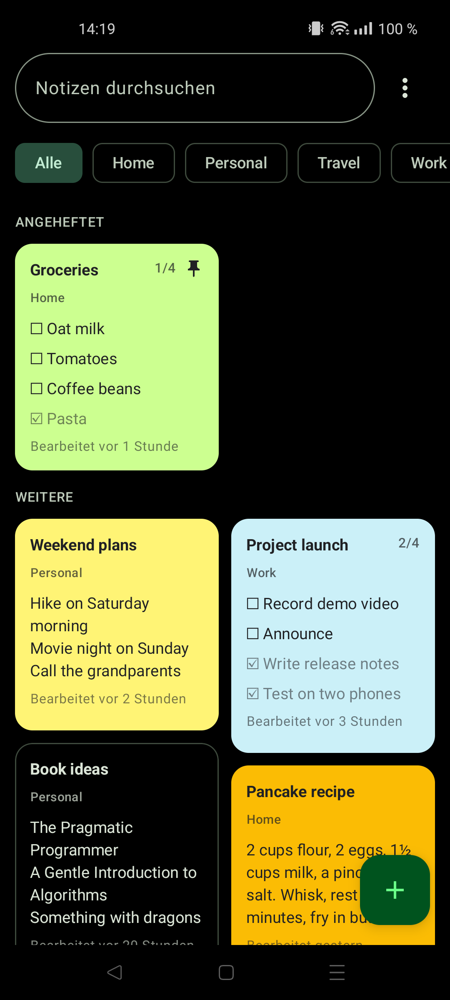
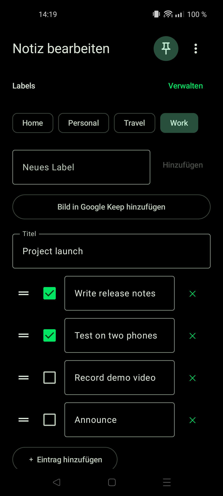
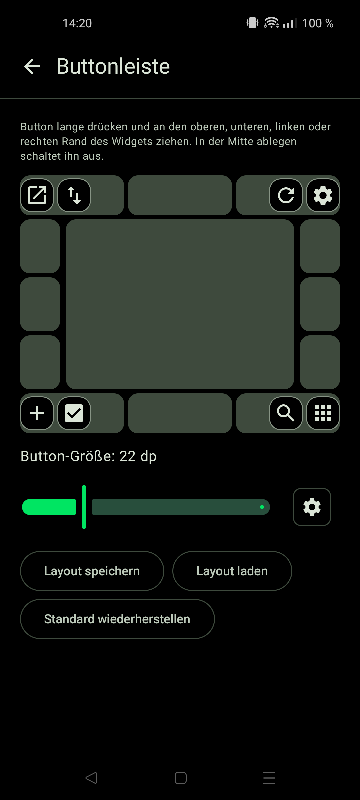
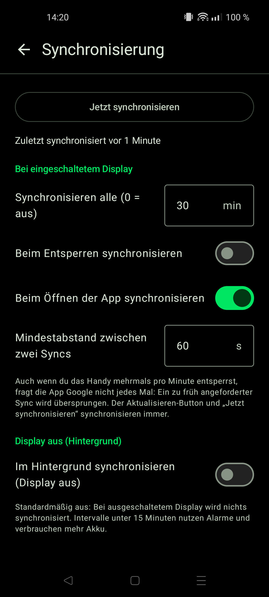

# GKeepDroid

An Android home screen widget for your Google Keep notes, with a background you can make fully transparent.

The official Keep widget has a fixed background. This one lets you choose the background opacity, text color and text size, shows Keep's note colors, and lets you edit notes and create new ones right from the widget.

## Screenshots

Made with the demo mode, so they show sample notes.

| Notes | Editor |
|---|---|
|  |  |

| Button bar | Synchronization |
|---|---|
|  |  |

## Features

- Transparent (0–100 %) widget background, adjustable text color and size
- Keep note colors (optional, with their own opacity); notes without a color can be transparent, gray or get a border
- Notes, checklists, images and drawings (shown as thumbnails)
- A "+ Add item" row at the end of every checklist; share a note to other apps from the editor menu
- Add items to a shopping list straight from the single-note widget (a small dialog, several in a row)
- Share text or a link from any app to "GKeepDroid" to create a note
- Edits made without a connection are kept and sent later
- Notes can hide their content in the widgets (only the title and a lock show)
- Optional: text color that follows the system theme, "edited 2 days ago", a maximum number of lines per note
- Sorting per widget: Keep order, last edited, date created, title or manual (arrow buttons); Keep's pinned notes first (optional)
- Hide single notes in a widget. Pinning a note uses Keep's own pin (synced with Google Keep); pinned notes show a small pin. A note can also be shown at the bottom of one widget (a widget-only option)
- Keep labels: assign existing labels or create new ones in the editor (synced with Keep, also in local mode and in the Markdown header), shown on the cards of the app and the widgets (switchable), and searchable
- Notes without title and text show an italic hint instead of an empty card
- A second widget, **Keep Note**, shows a single note or checklist, e.g. a shopping list. Pick the note in its settings
- Optional search button in the widget's button bar: it opens a search screen with live results (title, text and checklist items); a tap on a result opens the note
- Search field at the top of the settings to find any setting by name
- "Open note in Google Keep" in the opened note (app if it handles the link, otherwise keep.google.com)
- Button that opens the Google Keep app, or keep.google.com in the browser when the app is not installed
- Tap a note to edit it; add new notes and checklists from the widget header
- Button bar (one consistent icon set): refresh, new note, new checklist, sort, search, open GKeepDroid, open Keep, settings. Every button can be switched off or assigned to its own side (top, bottom, left or right) with drag & drop, and placed at the start, middle or end of their bar by dropping them there (a marker shows where a button lands)
- If the settings button is off (a confirmation asks first), the settings stay reachable via Android Settings › Apps › GKeepDroid › App settings or the launcher's "Reconfigure"
- Sign in with Google in the app (no master token to copy), or keep using a master token; or use the app **without any account**, with notes that only exist on the device
- Several Google accounts; every widget instance has its own account and its own appearance settings
- Checklists: tick items right in the widget (optional, synced a few seconds after the last tick), checked items move to the end and can be collapsed, item spacing slider, checkbox style (square, rounded, circle, classic) and a checkbox size that is independent of the text size; optionally tick by tapping anywhere on the row
- Settings in three levels: global (accounts, sync, theme, Markdown folder, backup), the app view (layout, sorting, card look), and each widget separately. Opened from the app they list the placed widgets; opened from a widget they lead with that widget's settings
- Checklists: drag items by their handle to re-order them, and see the progress (3/7) in the title line
- Undo after archiving or trashing a note, launcher shortcuts (new note, new checklist, search) and a Quick Settings tile for a new note
- Private notes hide their content on the cards and open only after the device lock (PIN, pattern, fingerprint)
- Sync status: when the last sync worked, and why it failed if it did
- Drag & drop in the app: long-press a note and move it; in "Keep order" the new place is saved to Keep itself
- Filter by label: a label bar in the app, and "only notes with label X" per list widget
- Changes made without a connection (also labels and the order of notes) are kept and sent later; an expired sign-in is shown with a button to sign in again
- Demo mode (Settings › Global): every account shows generic sample notes and a dummy address, and nothing is sent to Keep. For screenshots
- Notes are refreshed from Keep when you open them, so you never edit a stale copy
- Button bar (refresh, new note, ...) can sit above or below the notes and has an adjustable size
- Custom text color picker
- **Markdown folder, synced both ways**: every note is its own `.md` file in a folder you pick (one subfolder per account). Edit a note in the widget or in Keep and the file changes; edit the file in another app (Obsidian, Markor, ...) and the note changes. New `.md` files become new notes. A header in each file holds the note's id, color and pin
- Settings export and import (JSON). Neither the master token nor e-mail addresses are exported
- Sync you control: an interval in minutes while the display is on, separate switches for syncing when the phone is unlocked and when the app is opened, optional background sync with its own interval (off by default, nothing is synced while the display is off), a minimum gap between automatic syncs (frequent unlocking does not flood Google's servers) and an option for no sync on mobile data. Keep has no push channel for other apps, so changes made elsewhere arrive at the next sync
- Theme: follows the system (Material You), light, dark or OLED black
- A full-screen app with its own launcher icon: all notes in a grid, search, new notes and checklists, archive and trash with restore. The widgets and the app share the same notes
- Settings open when adding a widget, from the ⚙ button, from the app's menu, or from the launcher's "reconfigure" action
- Translated into English, German, Spanish, French, Italian, Portuguese, Dutch, Polish, Russian, Turkish, Chinese, Japanese, Korean, Arabic and Hindi

> **Not affiliated with Google.** GKeepDroid is an independent, unofficial project. Google Keep and Google are trademarks of Google LLC. This app is neither made, endorsed nor supported by Google.

## How it works

Google Keep has no public API for personal Google accounts. This app uses the unofficial
[gkeepapi](https://github.com/kiwiz/gkeepapi) library, which runs inside the app through
[Chaquopy](https://chaquo.com/chaquopy/). It signs in with a **master token**.

> **Warning**
> - gkeepapi is unofficial and may stop working at any time. Using it may violate Google's terms of service. Use it at your own risk.
> - A master token grants broad access to your Google account, not just Keep. Never share it and never commit it.
> - The token is entered in the app at runtime and stored encrypted with the Android Keystore. It is not part of this repository.

## Getting a master token

Follow the instructions of [gpsoauth](https://github.com/simon-weber/gpsoauth) or the
[gkeepapi documentation](https://gkeepapi.readthedocs.io/en/latest/#obtaining-a-master-token).
A master token starts with `aas_et/`. The app links to the same instructions from the Accounts tab:
<https://gkeepapi.readthedocs.io/en/latest/#obtaining-a-master-token>

## Building

Requirements:

- JDK 17 (a full JDK with `javac`, not just a JRE)
- Android SDK with platform 37 and build tools (`ANDROID_HOME` set, or `sdk.dir` in `local.properties`)
- Python 3.13 on the build machine (Chaquopy needs a build Python that matches the app's Python version)

Create `local.properties` (it is git-ignored):

```properties
sdk.dir=/path/to/Android/Sdk
chaquopy.buildPython=/path/to/python3.13
```

Then build and install:

```sh
export JAVA_HOME=/path/to/jdk-17
./gradlew :app:assembleDebug
adb install -r app/build/outputs/apk/debug/app-debug.apk
```

## Usage

1. Long-press the home screen, open Widgets and add **GKeepDroid**.
2. In the configuration screen, open **Accounts** and add your Google account (e-mail and master token).
3. Open the entries of the settings list (Appearance, Notes, Checklists, Button bar, ...), Changes are saved as you make them.

Open the ⚙ button of a widget (or long-press the widget and choose reconfigure) to change its settings later.
Add more accounts under Accounts, where you also pick the account per widget.

## Project layout

| Path | Purpose |
|---|---|
| `app/src/main/python/keep_bridge.py` | gkeepapi calls: sync, update and create notes |
| `app/src/main/java/com/gkeepdroid/NotesWidget.kt` | List widget (all notes of an account) |
| `app/src/main/java/com/gkeepdroid/SingleNoteWidget.kt` | Single-note widget |
| `app/src/main/java/com/gkeepdroid/WidgetParts.kt` | Parts shared by both widgets (button bar, checklist rows, refresh) |
| `app/src/main/java/com/gkeepdroid/NoteImages.kt` | Image thumbnails |
| `app/src/main/java/com/gkeepdroid/SettingsActivity.kt` | Widget configuration and settings screen |
| `app/src/main/java/com/gkeepdroid/Backup.kt` | Settings export/import (no tokens) |
| `app/src/main/java/com/gkeepdroid/EditNoteActivity.kt` | Note editor |
| `app/src/main/java/com/gkeepdroid/KeepRepository.kt` | Runs Python calls, refreshes cache and widget |
| `app/src/main/java/com/gkeepdroid/SyncWorker.kt` | Periodic and manual background sync |

## Sync

Each account keeps its incremental sync state, so a sync only transfers changes. A sync runs once per account
no matter how many widgets use it, widgets are only redrawn when notes actually changed, and nothing is synced
while no widget is placed.

## Limitations

- Needs a network connection to sync and to save edits.
- Images and drawings are shown as a thumbnail (the first one per note) and cannot be edited here; audio is ignored.
- Archived and trashed notes are hidden.

## Automatic builds and releases

The workflow in `.github/workflows/build.yml` builds the debug APK on every push and pull request and keeps it
as a download of the run ("Artifacts"). It is signed with a debug key, so Android may warn when installing it.

### Signed release

1. Create a key once and keep it safe (without it, installed apps can never be updated):

   ```sh
   keytool -genkeypair -v -keystore gkeepdroid.jks -alias gkeepdroid -keyalg RSA -keysize 4096 -validity 10000
   ```

2. Add four secrets to the GitHub repository (Settings › Secrets and variables › Actions):
   `KEYSTORE_BASE64` (`base64 -w0 gkeepdroid.jks`), `KEYSTORE_PASSWORD`, `KEY_ALIAS`, `KEY_PASSWORD`.
3. Raise `versionCode` and `versionName` in `app/build.gradle.kts`, then push a tag:

   ```sh
   git tag v0.2.0 && git push origin v0.2.0
   ```

   The workflow builds `gkeepdroid-v0.2.0.apk`, signed with your key, and attaches it to a GitHub release.

To build a signed release locally, add `keystore.path`, `keystore.password`, `key.alias` and `key.password` to
`local.properties` and run `./gradlew :app:assembleRelease`. Check the signature with
`apksigner verify --print-certs app/build/outputs/apk/release/app-release.apk`.

## License

GPL-3.0, see [LICENSE](LICENSE).
